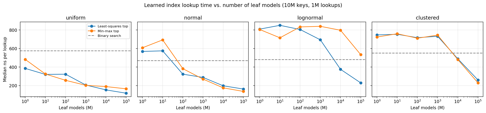
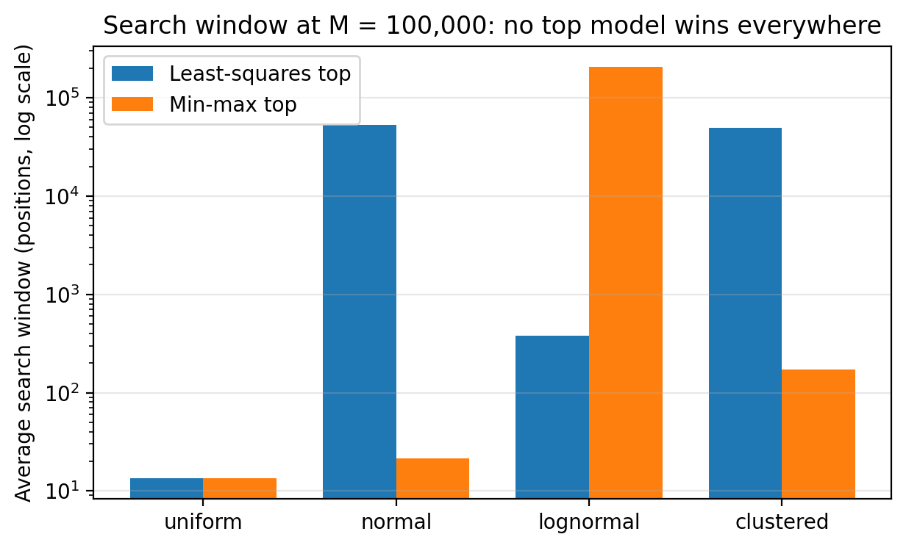

# When Do Learned Indexes Beat Binary Search?
### How data distribution and top-model design shape a two-stage learned index

A learned index replaces a classic search structure with a model that predicts where a key
sits in a sorted array, then searches only a small window around the prediction. This
mini-study asks: **how much faster than binary search is a simple two-stage learned index,
and how does that depend on the data distribution and on the design of the top model?**

## Setup
- **Data:** four sorted arrays of 10 million unique float64 keys (80 MB each, larger than CPU
  cache): uniform, normal, lognormal, and clustered (20 narrow clusters).
- **Baseline:** binary search over the full array.
- **Learned index:** a two-stage recursive model index (RMI). A top model routes each key to
  one of M leaf models (M = 1 to 100,000); each leaf is a least-squares line with recorded
  minimum/maximum error, so the final search is a binary search inside a guaranteed window.
  Two top models are compared: a least-squares line, and min-max routing (equal slices of the
  key range).
- **Measurement:** 1 million lookups of existing keys per configuration, implemented in
  Python with Numba (compiled loops); median of 7 runs. Every result was checked against the
  true positions, and a fallback counter confirmed the error bounds were never violated.

## Results
**1. Learned indexes can be several times faster than binary search.** With 100,000 leaf
models and the better top model for each dataset, lookups were 4.9× faster on uniform data
(118 vs. 575 ns), 3.4× on normal, 2.4× on clustered, and 2.1× on lognormal. The model
occupied about 3.9 MB, under 5% of the data size.

**2. Data distribution decides whether small models help at all.** On uniform data even a
single linear model beat binary search, but on lognormal and clustered data, indexes with up
to about 1,000 leaf models were slower than binary search, because their predictions were
far enough off to require large search windows.

**3. The top model limits the whole index.** With a least-squares top model, the average
search window on normal and clustered data plateaued around 50,000 positions from 1,000 to
100,000 leaves. A diagnostic showed why: the straight-line top model predicted leaf numbers
outside the valid range for the tails, so 7.6% (normal) and 10% (clustered) of all keys were
clipped into the first or last leaf, which no single line can fit.

**4. No single top model works best everywhere.** Min-max routing removes the clipping,
shrinking the average window about 2,500× on normal and 290× on clustered data, but makes
lognormal about 550× worse, because most lognormal keys fall into a few slices of the key
range. Robust learned indexes therefore need designs that adapt to the data.

## Limitations
- Synthetic data only; real-world key sets (e.g., the SOSD benchmark) would be more convincing.
- Python with Numba rather than C++; absolute timings are indicative only.
- Timings come from a shared cloud machine and vary by up to ~40% between runs, so only large
  differences are interpreted.
- Average search window is dominated by the few keys in very large windows; it overstates the
  window for a typical lookup.
- Lookups of existing keys only; no inserts, range queries, or comparison with B-trees or
  modern learned indexes such as PGM-index or RadixSpline.

## Reproducing
Open `learned_index.ipynb` in Google Colab (NumPy, pandas, Numba).

## Reference
Kraska, T., Beutel, A., Chi, E. H., Dean, J., & Polyzotis, N. (2018). The Case for Learned
Index Structures. *Proceedings of SIGMOD 2018*.
